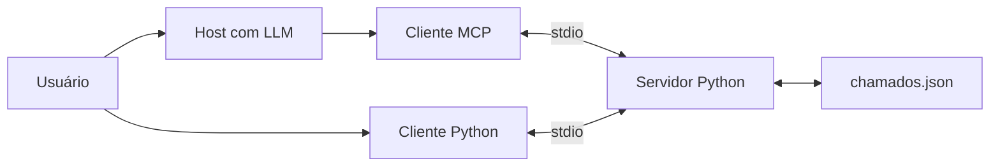
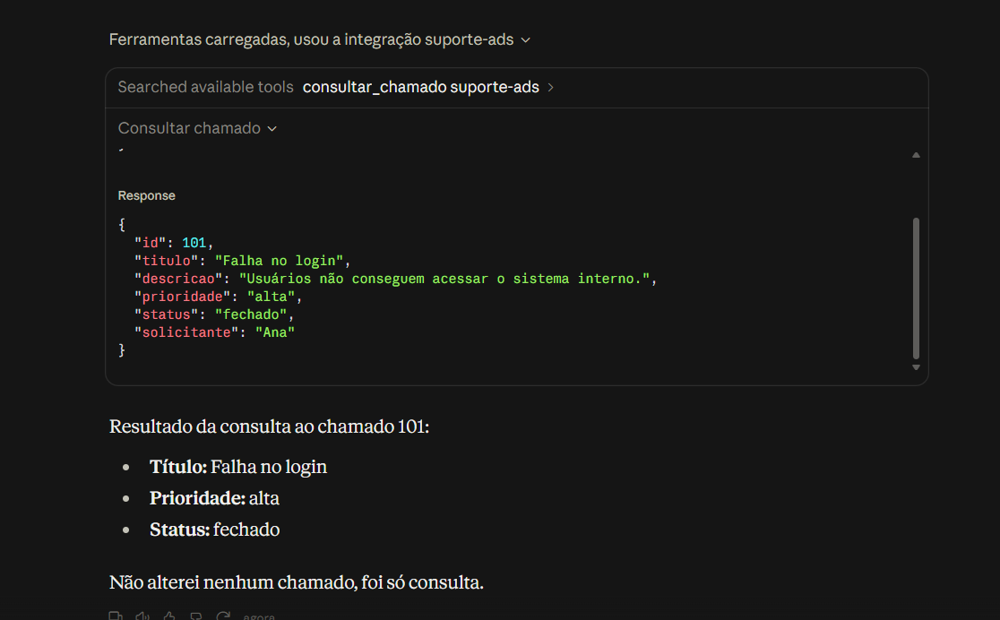
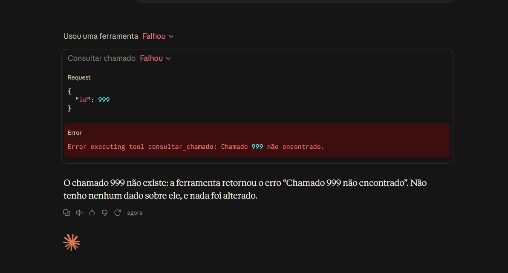

# Implementação de MCP em um assistente de suporte

**Curso:** Análise e Desenvolvimento de Sistemas — 6º semestre  
**Integrantes:** Beatriz Miranda Solera e Giovana Isis Ferreira da Silva  
**Disciplina:** Tópicos Especiais em Informática  
**Professor(a):** Túlio Santos de Souza
**Data:** 09/10/2026

## 1. Introdução

Este trabalho apresenta a implementação de um servidor baseado no Model Context Protocol (MCP) para disponibilizar dados fictícios de chamados de suporte a uma aplicação cliente. A proposta demonstra como um modelo de IA pode consultar informações externas por meio de capacidades padronizadas, reduzindo a dependência de informações memorizadas pelo próprio modelo.

## 2. Objetivo

Implementar e testar um servidor MCP para consultar, listar, filtrar e fechar chamados fictícios. O servidor disponibiliza duas Resources, quatro Tools e um Prompt, com persistência em JSON e confirmação no cliente antes do fechamento. Também se busca demonstrar a diferença entre chamadas determinadas por código e ferramentas utilizadas por uma LLM para fundamentar respostas.

## 3. Tecnologias utilizadas

- Python 3.12.3;
- SDK oficial MCP para Python, versão 1.30.0;
- transporte local stdio e mensagens JSON-RPC gerenciadas pelo SDK;
- JSON para persistência dos chamados;
- módulo logging para registros em stderr;
- test_client.py para testes determinísticos do protocolo;
- cliente_operacao.py para fechamento com confirmação;
- Claude Desktop como host com LLM;
- requirements-lock.txt para registrar as versões das dependências.

## 4. Arquitetura

Na integração com IA, o Claude Desktop atua como host e mantém um cliente MCP. O cliente inicia o servidor Python e troca mensagens pelo transporte stdio. O servidor executa as ferramentas e acessa somente dados/chamados.json, cujo caminho é calculado a partir de `__file__`.

Nos testes pelo terminal, os clientes Python iniciam o servidor diretamente. test_client.py realiza chamadas determinadas pelo código, sem LLM. cliente_operacao.py solicita confirmação antes de iniciar a conexão e chamar a ferramenta de fechamento.



O SDK cuida da inicialização, descoberta de capacidades e troca de mensagens. As funções do servidor são responsáveis pelas regras de validação, consulta e persistência.

## 5. Capacidades implementadas

### 5.1 Resources

suporte://politica apresenta as regras de uso dos dados fictícios e as limitações de segurança. suporte://chamados disponibiliza os registros atuais do arquivo JSON.

### 5.2 Tool: consultar_chamado

Recebe um ID inteiro positivo e retorna o chamado correspondente. IDs inválidos ou inexistentes produzem erro sem criar registros.

### 5.3 Tool: listar_chamados

Lista os chamados e permite filtros opcionais por status aberto ou fechado e prioridade alta, media ou baixa. Valores não permitidos são rejeitados.

### 5.4 Tool: filtrar_chamados

Recebe uma prioridade obrigatória: alta, media ou baixa. Retorna os chamados correspondentes, ou uma lista vazia quando não houver resultados. Prioridades inválidas produzem erro.

### 5.5 Tool: fechar_chamado

Valida o ID, lê os registros, altera o status para fechado e salva no JSON. Se o chamado já estiver fechado, retorna alterado=false sem regravar o arquivo. IDs inexistentes produzem erro.

### 5.6 Prompt: analisar_chamado

Retorna instruções para consultar os dados pela ferramenta e analisar título, prioridade e status sem inventar informações. O próprio Prompt não executa a consulta nem contém uma LLM. O cliente envia seu argumento ID como texto, conforme o formato do protocolo de Prompts.

## 6. Segurança, rastreabilidade e limitações

O servidor acessa um arquivo de dados com caminho fixo, calculado a partir de `__file__`. Não são expostas ferramentas para shell, SQL livre ou acesso a caminhos arbitrários. As entradas são validadas pelas funções e pelo SDK.

O cliente de operação solicita confirmação antes da conexão e da chamada de escrita. Quando a confirmação é negada, retorna sem chamar a ferramenta. Na demonstração com Claude Desktop, as chamadas de leitura foram autorizadas individualmente, usando a opção Permitir uma vez.

A confirmação no cliente é um controle de fluxo, não autenticação no servidor. Outro cliente MCP pode chamar a ferramenta diretamente. O uso de ferramentas de escrita no host deve exigir aprovação individual ou permanecer desabilitado.

Os logs incluem timestamp, nome da operação, ID quando aplicável e resultado de sucesso ou erro. São enviados para stderr, preservando stdout para o protocolo. A função auditar_ferramenta registra as execuções e os erros ocorridos dentro das ferramentas; entradas com tipos inválidos também podem ser rejeitadas pelo SDK antes da execução.

A solução é uma demonstração local. Não implementa autenticação por usuário, controle de acesso por perfil, bloqueio de escrita concorrente ou transações. A escrita simples em JSON também não oferece garantia de atualização atômica em caso de interrupção.

## 7. Plano de testes e resultados

Os testes foram executados no Windows, com Python 3.12.3 e SDK MCP 1.30.0. O cliente de verificação realizou chamadas pelo protocolo MCP. O cliente de operação verificou o fechamento com confirmação. A integração com LLM foi demonstrada no Claude Desktop.

| Teste | Entrada ou ação | Resultado esperado | Resultado observado |
|---|---|---|---|
| Inicialização e descoberta | Executar test_client.py | Conexão e descoberta das capacidades | Aprovado: quatro Tools, duas Resources e um Prompt encontrados |
| Resources | Ler suporte://politica e suporte://chamados | Política e registros disponíveis | Aprovado: política retornada e JSON lido |
| Consulta válida | ID 101 | Dados correspondentes ao JSON | Aprovado: Falha no login, prioridade alta e status correspondente ao arquivo |
| Registro ausente | ID 999 | Erro sem criar registro | Aprovado: Chamado 999 não encontrado |
| ID negativo | ID -1 | Rejeição sem alteração | Aprovado: erro de inteiro positivo |
| Texto inválido | ID abc | Rejeição sem alteração | Aprovado: erro de validação de inteiro pelo SDK |
| Filtro por prioridade | alta, media e baixa | Apenas registros da prioridade solicitada | Aprovado: alta retornou 101 e 104; media retornou 102; baixa retornou 103 |
| Prioridade inválida | urgente | Erro de validação | Aprovado: prioridade rejeitada |
| Status inválido | urgente | Erro de validação | Aprovado: status rejeitado |
| Confirmação negada | Fechar 101 e responder nao | Cancelar antes da chamada de escrita | Aprovado: mensagem de cancelamento e chamado 101 permaneceu aberto |
| Confirmação aceita | Fechar 101 e responder sim | Salvar status fechado no JSON | Aprovado: alterado=true e status fechado no arquivo |
| Persistência | Executar novamente test_client.py | Novo processo retornar status fechado | Aprovado: consulta 101 continuou retornando fechado |
| Fechamento repetido | Fechar 101 novamente | Informar que já estava fechado | Aprovado: alterado=false e mensagem de chamado já fechado |
| Prompt | analisar_chamado com ID textual 101 | Retornar instruções de análise | Aprovado: instruções retornadas |
| Integridade nos testes de leitura | Comparar registros antes e depois | Nenhuma alteração | Aprovado: comparação por assert passou |
| IA: consulta válida | Claude consulta 101 pela ferramenta | Resposta fundamentada no retorno | Aprovado: título, prioridade e status coincidiram com os dados retornados |
| IA: registro ausente | Claude consulta 999 pela ferramenta | Informar ausência sem inventar dados | Aprovado: Claude informou que o chamado não existe |
| IA: listagem | Claude usa listar_chamados | Identificar os chamados de prioridade alta | Aprovado: identificou 101 e 104 |
| Rastreabilidade | Consultar os logs do servidor | Registrar timestamp, operação, ID e resultado | Aprovado: consultas 101 e 999 e listagem registradas com sucesso ou erro |

## 8. Resposta do modelo versus operação de ferramenta

O cliente test_client.py executa chamadas determinadas pelo código, sem utilizar uma LLM. Ele verifica o funcionamento do protocolo MCP, mas não demonstra um modelo decidindo consultar ferramentas.

Na integração com Claude Desktop, o modelo recebeu solicitações em linguagem natural e utilizou as ferramentas do servidor. As evidências mostram a chamada, os argumentos, o resultado e a resposta textual fundamentada nos dados retornados.

Na consulta ao chamado 101, a ferramenta retornou o título Falha no login, prioridade alta e status fechado. O Claude apresentou essas mesmas informações. O status fechado correspondia à alteração anteriormente persistida pelo cliente de operação.

Na consulta ao ID 999, a ferramenta retornou o erro Chamado 999 não encontrado. O Claude informou que o registro não existia, sem inventar dados. Na listagem, identificou corretamente os chamados 101 e 104 como os de prioridade alta.

Uma resposta textual dizendo que um chamado foi fechado não comprova a execução da operação. No teste de fechamento, a evidência foi o retorno alterado=true, acompanhado da mudança no JSON e da consulta em um novo processo mantendo o status fechado. Na repetição, o retorno alterado=false indicou que o chamado já estava fechado.

## 9. Conclusão

Os testes demonstraram a comunicação cliente-servidor por MCP, a descoberta das capacidades, a leitura das Resources, a obtenção do Prompt e a execução das ferramentas. As entradas inválidas foram rejeitadas e os testes de leitura preservaram os registros.

A implementação autoral acrescentou filtragem por prioridade, persistência em JSON e fechamento com confirmação no cliente. A persistência foi verificada ao iniciar um novo processo e consultar o chamado fechado. O comportamento de fechamento repetido também foi definido e testado.

A demonstração com Claude Desktop permitiu comparar as respostas da IA com os resultados efetivamente retornados pelas ferramentas. Os logs registraram operações bem-sucedidas e erros, permitindo acompanhar as consultas realizadas.

A solução permanece limitada a uma demonstração local. A confirmação no cliente não autentica quem acessa o servidor, e o projeto não implementa autorização por usuário, transações ou controle de concorrência. Esses controles seriam necessários para uma evolução voltada ao uso por múltiplos usuários.

## 10. Evidências

As capturas completas acompanham o relatório na pasta evidencias.

| Evidência | Arquivo | O que demonstra |
|---|---|---|
| Confirmação e fechamento | [Captura 1](evidencias/01_confirmacao_fechamento.png) | Cancelamento, confirmação aceita e status fechado salvo no JSON |
| Servidor conectado | [Captura 2](evidencias/02_servidor_conectado.png) | Servidor suporte-ads em execução no Claude Desktop |
| Consulta com IA | [Captura 3](evidencias/03_ia_consulta_101.png) | Retorno do chamado 101 e resposta coerente da IA |
| Registro ausente | [Captura 4](evidencias/04_ia_consulta_999.png) | Argumento 999, erro da ferramenta e resposta sem inventar dados |
| Listagem com IA | [Captura 5](evidencias/05_ia_listagem.png) | Uso da listagem e identificação dos chamados 101 e 104 como prioridade alta |
| Argumentos da consulta 101 | [Captura 6](evidencias/06_ia_argumentos_101.png) | Ferramenta consultar_chamado chamada com o argumento id=101 |

### 10.1 Consulta fundamentada no retorno da ferramenta



### 10.2 Tratamento de chamado inexistente



### 10.3 Registros de execução

Trechos reais dos logs do servidor:

```text
2026-10-13 19:11:32,682 INFO operacao=consultar_chamado id=101 resultado=sucesso
2026-10-13 19:12:30,732 WARNING operacao=consultar_chamado id=999 resultado=erro detalhe='Chamado 999 não encontrado.'
2026-10-13 19:13:15,077 INFO operacao=listar_chamados id=None resultado=sucesso
```

Os registros permitem identificar quando a operação ocorreu, qual ferramenta foi executada, o ID quando aplicável e o resultado.
